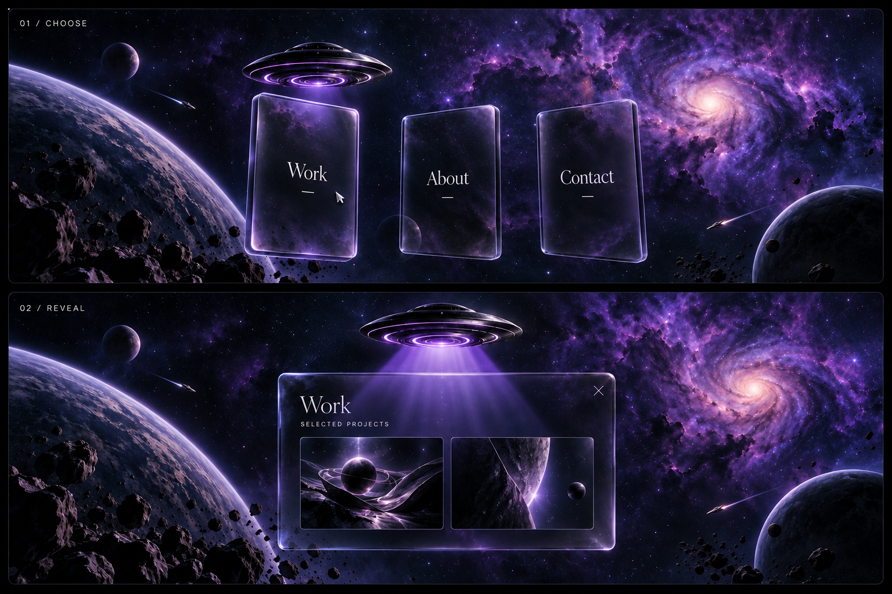

# Approved cinematic universe and glass navigation
Approved: 2026-10-28
Status: visual design checkpoint only; the interaction described here is not implemented by this commit.

## Preserve
Preserve the approved UFO departure/chase, detailed purple underside LEDs, subtle pulse, tilt, and gentle cursor camera pan. Use the project's supplied 3D models for implementation; the UFO and project thumbnails in this concept image are illustrative.

## Journey and composition
The UFO travels through space. Planets are scenery, not destinations or navigation waypoints. Place them deliberately for depth and composed reveals. A close planetary pass may briefly occlude the UFO before it emerges. Include restrained asteroids and passing ships with varied routes, distances, and speeds, timed to keep the main ship readable.
Camera angles may change for cinematic value. Coordinate position and look target so intermediate scroll frames are composed. Every pause should be screenshot-worthy. Scroll controls travel; ambient activity continues when travel settles. Keep a coherent violet, blue and occasional warm-light palette with dark negative space.

## First intentional stop
The UFO arrives above three portrait cards labeled Work, About and Contact (labels remain revisable). Frame the entire ship and cards. Provide breathing room in scroll progress at arrival without trapping scrolling.

## Card appearance and motion
- Taller portrait proportions; concept target width-to-height about 0.62.
- Increased spacing, roughly one third of a card width as a starting point.
- Translucent smoked black 3D glass, visible beveled thickness, restrained purple reflections and crisp text.
- Small cursor-responsive tilt, initial maximum about 5 degrees.
- Minimal drift around fixed anchors; cards stay within bounded positions and never collide.
- Smooth return to rest when pointer leaves. Tune these initial values in the actual scene.
- Keep bright scenery clear of text and preserve readability across screen sizes.

## Interaction sequence
1. Browsing: all three cards visible; UFO above the active card without obscuring its title.
2. Hover or keyboard focus: smoothly redirect the UFO over the relevant card. Focus alone does not open content.
3. Click, Enter, Space or touch activation: move/settle the UFO over the chosen card, then beam purple light onto it.
4. Reveal: selected card moves to the center and expands to reveal content; other cards disappear. Coordinate camera, beam and content in one continuous animation.
5. Reading: soften beam intensity so writing stays legible; keep content stable.
6. Close: visible X outside the strongest glow, also Escape; retract beam and restore all cards and focus to the selected card. Do not replay the space journey.
7. Touch: tap sequences positioning and activation because hover is unavailable.

## Implementation acceptance checks
- Validate actual 3D assets, desktop and narrow-screen framing.
- Rapid hover changes redirect smoothly; repeated activation cannot create overlapping transitions.
- Limit tilt and drift and respect reduced-motion preferences.
- Navigation supports keyboard focus, visible focus indicators, touch, close and focus restoration.
- Content remains readable through beam and background effects.
- Review many intermediate scroll positions, not only hero frames.
- This image is a visual reference, not a runtime background replacement for the 3D world.
